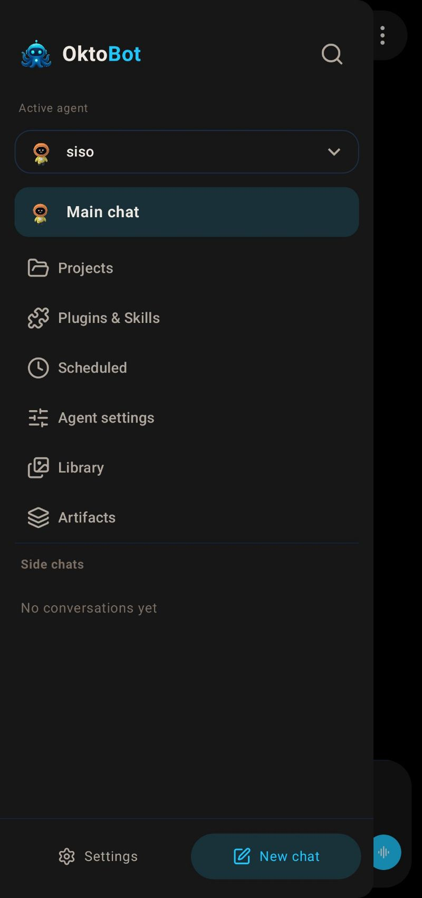
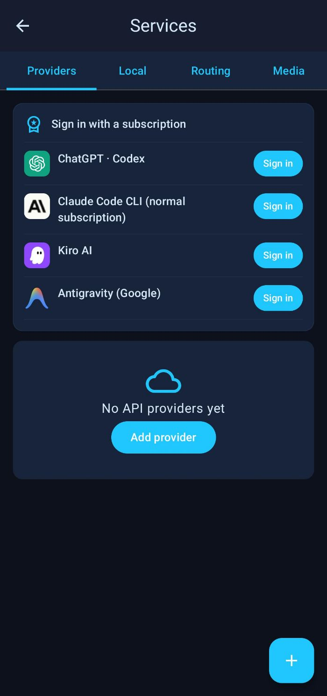
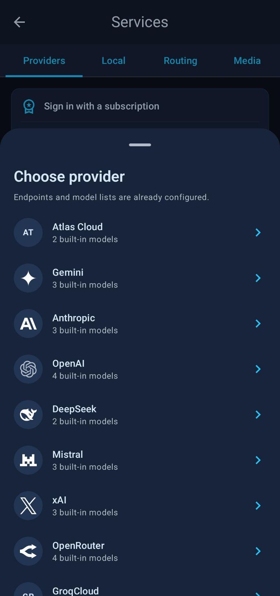
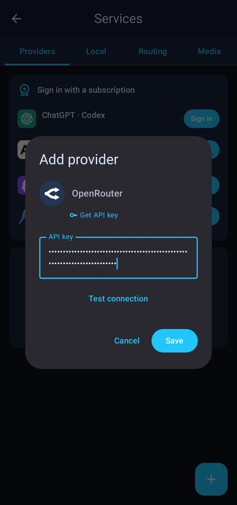
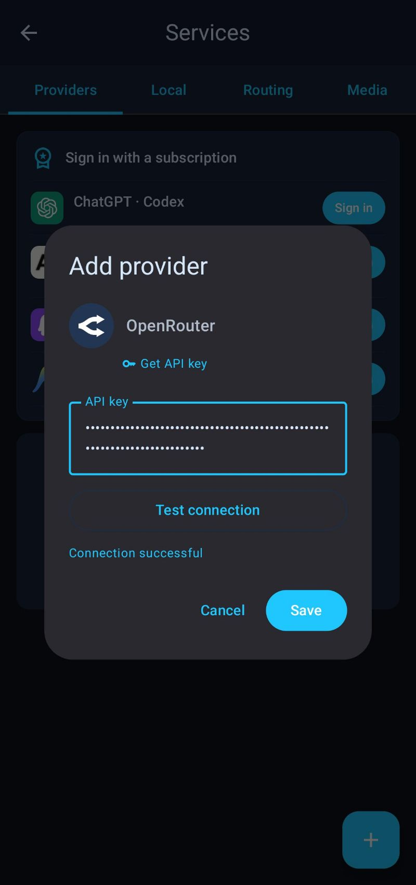
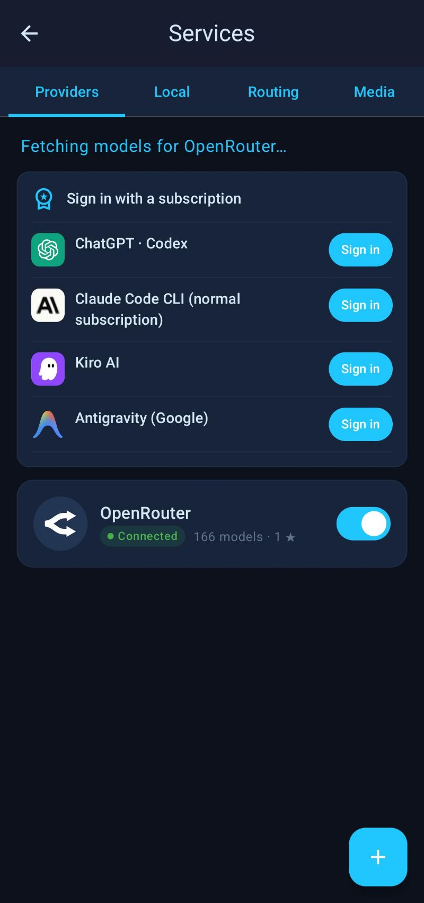
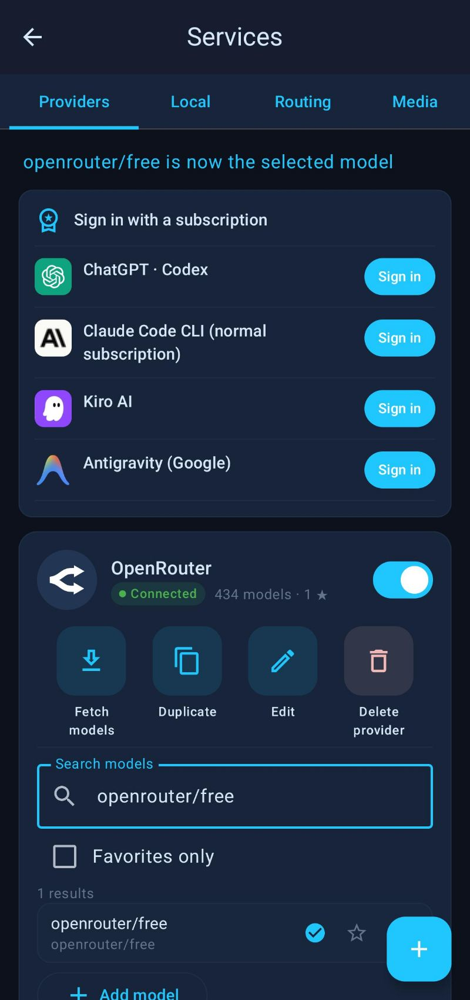
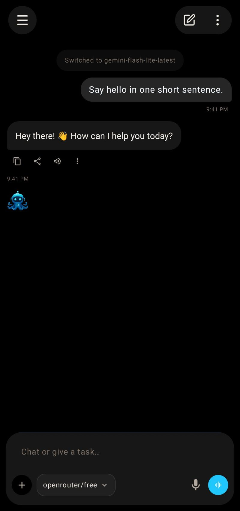

# Oktobot – how to test the AI features (Google Play review)

No account or login is needed. Oktobot needs one AI model to chat. Use the free OpenRouter test key given in the Play Console "Sign in details". It is a free-tier key with no credit, so it cannot incur charges.

IMPORTANT: choose the model `openrouter/free` (it always works). Do not pick other models.

1. Open the menu (top-left) – 
2. Settings – 
3. Model > LLM Config > "Add provider" (the Services screen) – 
4. Choose OpenRouter (scroll the list) – 
5. Paste the API key – 
6. Tap "Test connection" (shows "Connection successful"), then Save – 
7. OpenRouter shows "Connected" – 
8. Open the OpenRouter card, search "openrouter/free" and tap the circle. A banner says it is the selected model – 
9. Go back to the chat and send a message – 

Alternative without any key: Settings > Model > LLM Config > Local tab > download an on-device model.
