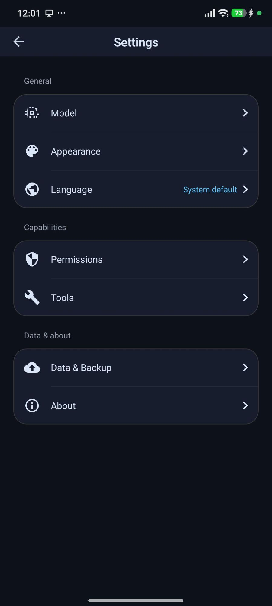
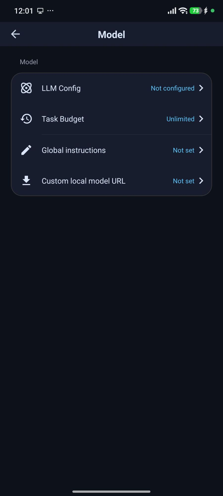
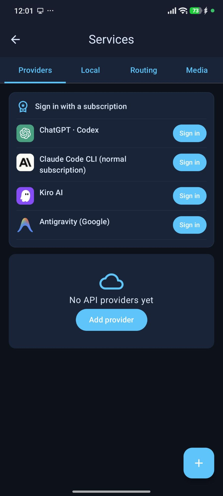
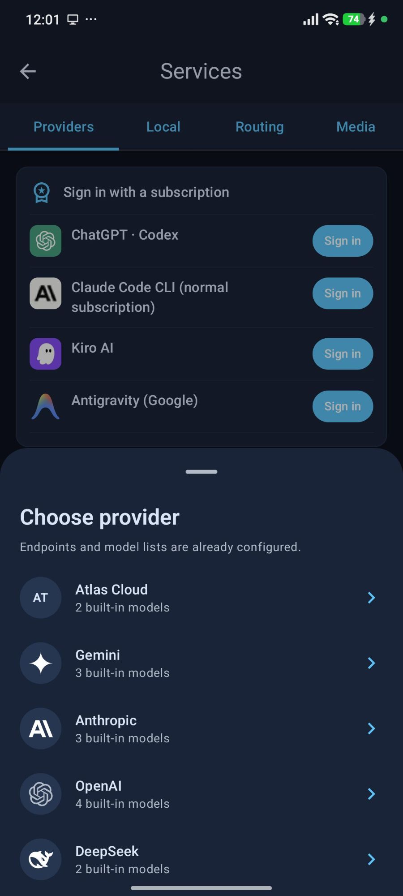
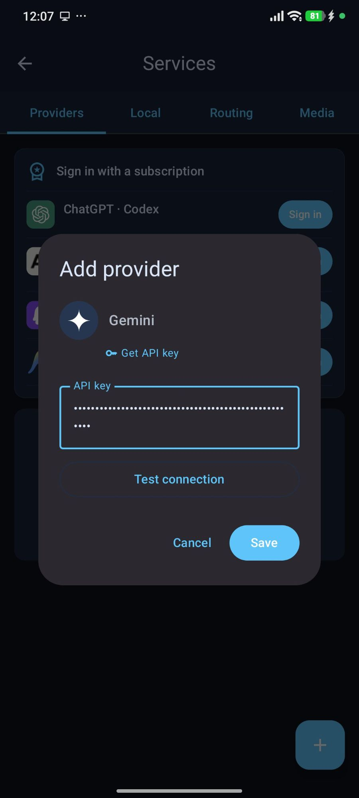
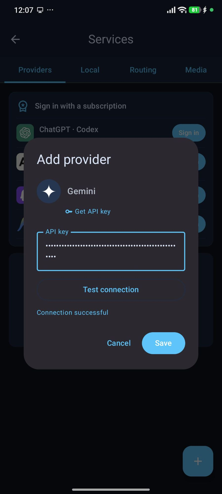
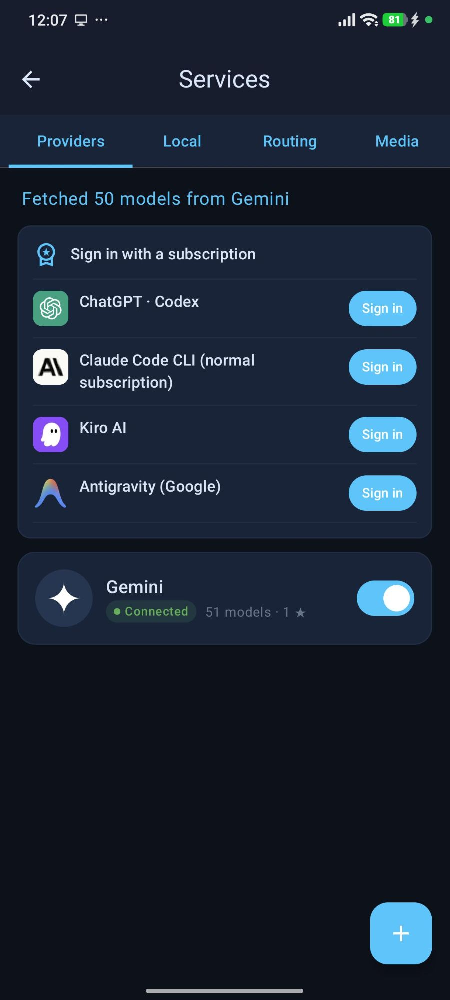
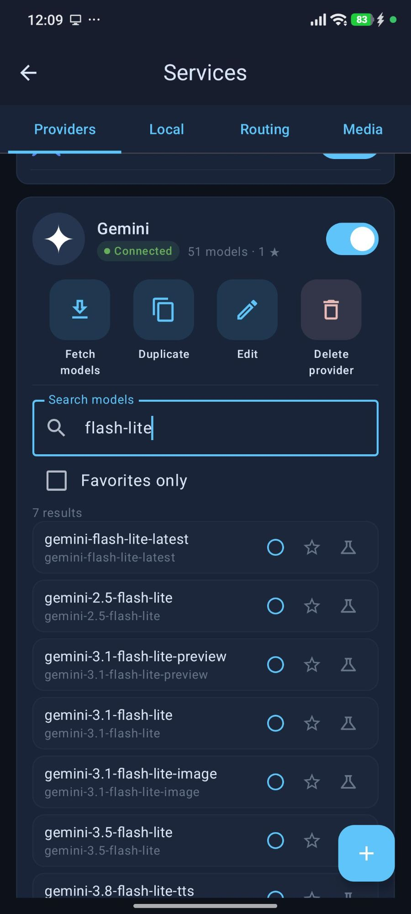
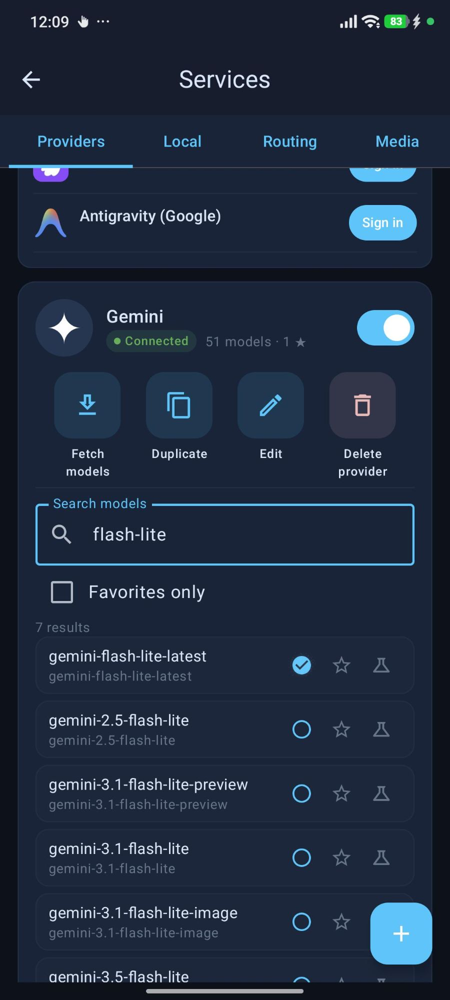
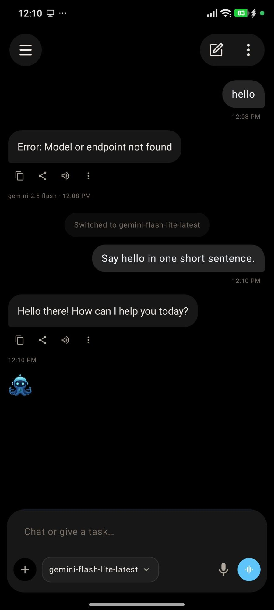

# Oktobot – how to test the AI features (for Google Play review)

No account or login is needed. To chat you need a model. Use the test Gemini API key given in the Play Console "Sign in details".

1. Open the menu (top-left) – 
2. Settings – 
3. Model – 
4. LLM Config > Add provider – 
5. Choose Gemini – 
6. Paste the API key – 
7. Test connection (shows "Connection successful"), then Save – 
8. Gemini shows Connected – 
9. IMPORTANT: choose the model `gemini-flash-lite-latest` (search "flash-lite") – 
10. Selected – 
11. Go back to the chat and send a message – 

Alternative without any key: Settings > Model > LLM Config > Local tab, download an on-device model.
